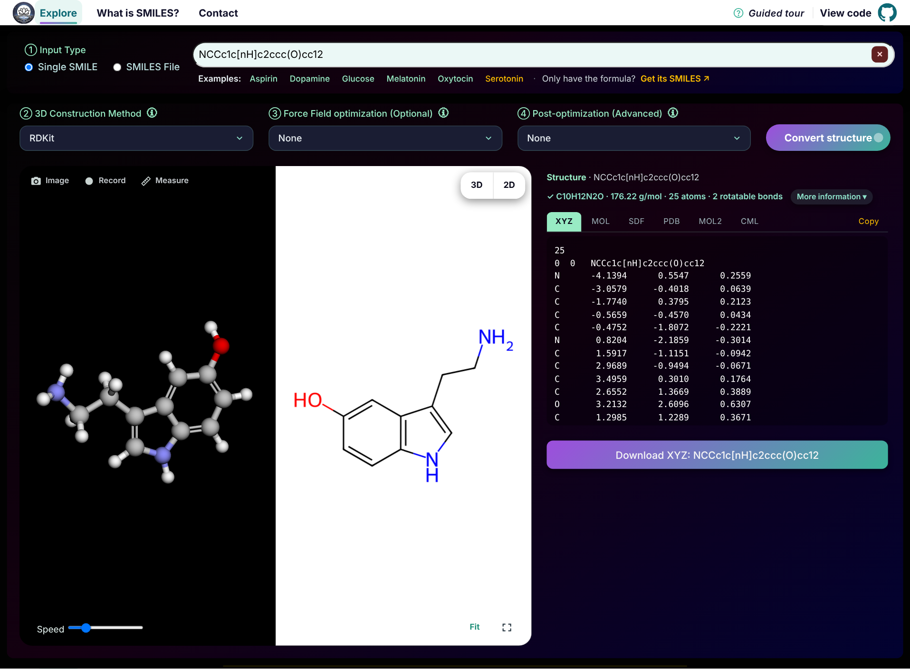
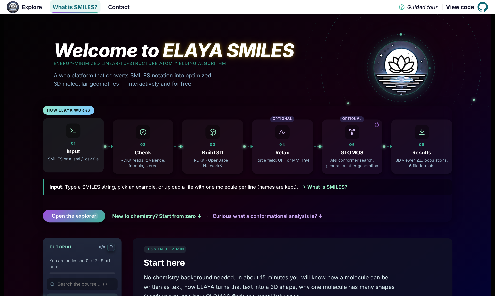
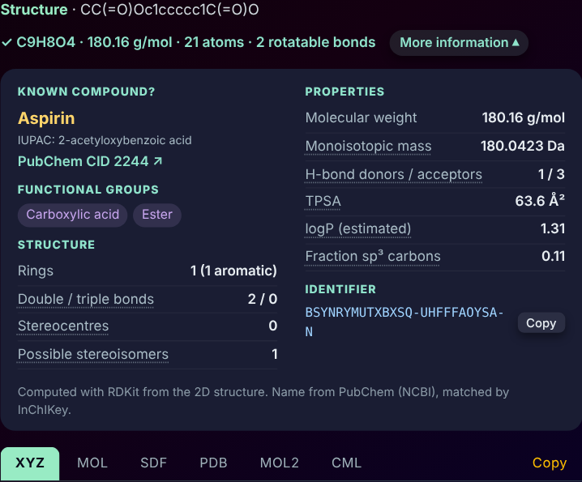

<p align="center">
  
</p>

<p align="center">
  <b>Energy-Minimized Linear-to-Structure Atom Yielding Algorithm</b><br/>
  Convert SMILES strings into optimized 3D molecular structures — interactively and for free.
</p>

<p align="center">
  <a href="https://elaya-smiles.onrender.com/">
    
  </a>
  
  
  
  
  
</p>

---

<p align="center">
  
  <br/><sub><i>The explorer: type a SMILES (or pick an example), convert it, and inspect it in 3D and 2D side by side</i></sub>
</p>

---

## What is ELAYA SMILES?

**ELAYA SMILES** is a web platform that converts linear molecular representations (SMILES) into optimized three-dimensional structures and lets you visualize, check, measure and export them in one place.

SMILES (Simplified Molecular Input Line Entry System) writes a molecule as a short line of text. Most computational chemistry — molecular simulations, docking, property prediction — needs accurate 3D geometries instead. ELAYA bridges that gap: it builds the 3D structure with established cheminformatics tools, checks it against the original SMILES, and can search for the most stable shapes (conformers) with ANI neural-network potentials. A built-in mini-course explains every step, so it works for research and for teaching.

---

## Features

- **SMILES → 3D in three ways** — RDKit (ETKDGv3), Open Babel, and NetworkX (Kamada-Kawai layout with chemical distance targets and stereo correction; approximate)
- **3D and 2D views** — independent switches (side by side, or one of them); rotate and zoom in 3D, zoom and pan in 2D; full screen; save an image or record a video of either view
- **Measure** — click atoms for distances (Å), angles and dihedrals (°); results can be copied
- **More information** — one click under the formula: known-compound name and CID from PubChem, functional groups, rings and stereo elements, and properties (mass, H-bond donors/acceptors, TPSA, logP, Fsp³) with plain-language explanations
- **Force-field optimization** — UFF or MMFF94
- **Conformational search with GLOMOS** — genetic algorithm in torsion space with ANI-1x / ANI-1ccx / ANI-2x; live progress, cancel, presets, reproducible seeds; a fast engine for large molecules (up to oxytocin, 135 atoms, on the free server)
- **Ensemble results** — relative energies, Boltzmann populations (298 K), rotational constants A/B/C, click-to-view conformers
- **Structure checks** — stereochemistry (CIP, E/Z) and the bond graph are verified against the SMILES; warnings for undefined stereocentres, salts, charge and the ANI domain
- **Batch input** — `.smi` / `.txt` / `.csv` files, validated line by line, with a downloadable example file
- **Export** — XYZ / MOL / SDF / PDB (RDKit), MOL2 / CML (Open Babel); multi-XYZ, JSON and ZIP for GLOMOS ensembles
- **"What is SMILES?" mini-course** — eight short lessons from zero (SMILES, 3D building, force fields vs ANI, conformers, GLOMOS) with a playground, quizzes, search and a guided tour of the explorer

---

## Screenshots

<table>
  <tr>
    <td align="center" width="50%">
      
      <br/><sub><b>How ELAYA works + the "What is SMILES?" mini-course</b></sub>
    </td>
    <td align="center" width="50%">
      
      <br/><sub><b>GLOMOS — conformers of oxytocin ranked with ANI-2x</b></sub>
    </td>
  </tr>
  <tr>
    <td align="center" width="50%">
      
      <br/><sub><b>More information — PubChem match, functional groups, properties</b></sub>
    </td>
    <td align="center" width="50%">
      
      <br/><sub><b>Contact — guided bug report, citation and FAQ</b></sub>
    </td>
  </tr>
</table>

---

## Scientific Highlights

**Distance geometry with torsional knowledge (ETKDGv3)** produces realistic conformations from experimental and knowledge-based constraints. **Force-field optimization** refines geometries with classical methods. **GLOMOS** (Genetic-algorithm-based Local Optimization of MOlecular Structures) goes further: a heuristic genetic algorithm explores the conformational space of rotatable bonds with ANI neural-network potentials, approaching quantum-chemical accuracy at a small fraction of the cost of DFT.

### Why 3D geometry matters

Accurate 3D structures are critical for molecular dynamics, structure-based drug design and quantum-chemical calculations. Molecules exist as ensembles of interconverting conformers, because of rotation around single bonds; finding the low-energy conformers is essential to understand how a molecule really behaves.

---

## Tech Stack

| Layer | Technologies |
|-------|-------------|
| Backend | Flask, Waitress (GLOMOS jobs run in a subprocess) |
| Cheminformatics | RDKit (ETKDG, MMFF94/UFF, descriptors), Open Babel, NetworkX |
| Conformational search | GLOMOS + TorchANI (ANI-1x / ANI-1ccx / ANI-2x), ASE |
| Known-compound lookup | PubChem PUG-REST (by InChIKey, cached) |
| Visualization | 3Dmol.js (3D), RDKit SVG depiction (2D) |
| Frontend | HTML5, CSS3, vanilla JavaScript |

---

## Getting Started

```bash
# Clone the repository
git clone https://github.com/GabrielaVidales/Elaya_SMILES.git
cd Elaya_SMILES

# Create and activate a virtual environment
python -m venv venv
source venv/bin/activate      # Windows: venv\Scripts\activate

# Install dependencies (torch CPU is installed separately, see requirements.txt)
pip install torch==2.2.2 --index-url https://download.pytorch.org/whl/cpu
pip install -r requirements.txt

# Run the server
python app.py
```

The app will be available at `http://localhost:5000`.

With Docker: `docker build -t elaya .` then `docker run -p 5000:5000 elaya`.

---

## Usage

1. Type a SMILES — or pick one of the built-in examples (Aspirin, Dopamine, Glucose, Melatonin, Oxytocin, Serotonin), or upload a `.smi` / `.txt` / `.csv` file. Only have a formula? The explorer links to [SMILX-isogenerator](https://smilx-isogenerator.streamlit.app/).
2. Choose a **3D Construction Method** (RDKit, Open Babel or NetworkX).
3. Optionally apply **Force Field optimization** (UFF, MMFF94).
4. Optionally run **GLOMOS** (post-optimization) for an ANI conformer search.
5. Press **Convert structure**, then explore the 3D/2D views, **Measure**, open **More information**, and download any format.

New to all this? Open **What is SMILES?** or press **Guided tour** in the top bar.

---

## GLOMOS in v2 (what it actually does)

1. **Seeds** — RDKit ETKDGv3 conformer pool (reproducible seed) and the chemistry-aware bond graph, built by the worker.
2. **Rotors** — acyclic single bonds not adjacent to a triple bond; symmetric tops (CH3, CF3, t-Bu) excluded; each rotor has a
   preferred-angle alphabet (sp3: 60/180/−60, X–H, planar amide/ester/acid: 0/180, otherwise 8 angles).
3. **Generation 0** — seeds + random torsion variants → ANI relaxation → energy window → USR/energy de-duplication.
4. **Evolution** — roulette selection, crossover of torsion vectors, mutants; every candidate must pass clash, connectivity,
   stereocentre and E/Z checks (before *and after* ANI relaxation). Stops on max generations, stagnation, time limit or cancel.
5. **Final polish** at fmax = 1e-3 eV/Å; ensemble with relative energies, populations and rotational constants.

**Large molecules (≥ 60 atoms with H) — fast engine.** Candidates are pre-relaxed with MMFF94 (twice as many are built and only the
lowest go to ANI; repeats of known conformers are skipped), screened with one ANI network in float32, the 4 best are polished, and
the final ranking uses all 8 networks of the ensemble as single points, loaded one at a time. The spread of the 8 networks is
reported next to the results. Oxytocin (135 atoms, 25 rotors) needs ~90 s of CPU and ~200 MB of private memory, about 15 minutes on
the free Render instance (0.1 CPU, 512 MB). GLOMOS accepts up to 140 atoms including hydrogens.

**Performance.** All candidates of a generation are relaxed together: one batched ANI evaluation per optimisation step
(`elaya_glomos/libbatch.py`, an exact re-implementation of `ase.optimize.LBFGS` run independently for every structure, so the
trajectories are identical to relaxing them one by one; checked in `tests/test_batch_relax.py`). On CPU this is ~2.5–3× faster.
Optional **screening with one ANI network** (`screening: "single"`, "Screening" in the GLOMOS panel) is ~3× faster again; the final
re-optimisation and ranking always use the full ensemble. Use the default (`"ensemble"`) for reference/published results.

ANI model *Auto* picks ANI-1ccx for H, C, N, O and ANI-2x when F, S or Cl is present. Open-shell molecules and elements outside
ANI are rejected with an explanation; charged species trigger a warning (ANI is trained on neutral molecules).

Command-line use (same code as the web job): see `validation/run_validation.py` and `glomos_worker.py`.

## API

| Endpoint | Purpose |
|---|---|
| `GET /api/health[?deep=1]` | library availability + versions; `deep=1` runs a real ANI calculation |
| `POST /api/analyze` | `{smiles}` → formula, descriptors, functional groups, stereo summary, InChI/InChIKey, warnings |
| `GET /api/pubchem/<inchikey>` | known compound? → `{found, cid, title, iupac}` (PubChem, cached) |
| `POST /api/validate` | `{smiles: [...]}` → quick check of many SMILES (file preview) |
| `POST /api/convert` | `{smiles, method: rdkit\|openbabel\|networkx, force_field}` → xyz, mol, QA, rotational constants |
| `POST /api/draw2d` | `{smiles}` → 2D depiction (SVG) |
| `POST /api/export` | `{smiles, xyz, format}` → file |
| `POST /api/glomos/start` | `{smiles, glomos_params}` → `{job_id, engine, notes}` (422 if the molecule is outside ANI or too large) |
| `GET /api/glomos/poll/<id>?cursor=n` | structured events, status, queue position |
| `POST /api/glomos/cancel/<id>` | cooperative cancel (partial result is kept) |
| `GET /api/glomos/result/<id>[?format=xyz]` | final ensemble |

Environment: `ELAYA_MAX_JOBS` (concurrent GLOMOS jobs, default 1), `ELAYA_MAX_MINUTES` (per-job limit, default 20),
`ELAYA_TORCH_THREADS` (`auto` = whole CPUs of the container), `ELAYA_ANI_DTYPE` (`float64` default),
`ELAYA_GLOMOS_MAX_ATOMS` (default 140), `ELAYA_LITE_MIN_ATOMS` (fast engine from this size, default 60),
`ELAYA_ANI_BATCH_ATOMS` (atoms per ANI pass, default 280), `ELAYA_WARMUP` (`0` disables preloading NetworkX/SciPy),
`ELAYA_JOB_TTL_MIN`, `ELAYA_CORS_ORIGINS`.

## Tests and validation

```bash
python -m pytest tests -q                 # 104 tests: chemistry, GA, jobs, API, UI contract (stand-ins if ase/rdkit/torch are absent)
python validation/run_validation.py       # real pipeline on butane, ethanol, pentane, aspirin, alanine (needs the full image)
python validation/benchmark_builders.py   # 13 molecules x 4 builders: bonds, stereo and time (results in benchmark_builders.json)
python validation/calculate_rotational_constants.py conformers.xyz
```

See `CHANGELOG.md` for what changed and why, and `docs/paper_vs_code.md` for the manuscript review.

## Limitations

Neutral closed-shell molecules (H, C, N, O; plus F, S, Cl with ANI-2x); relative **electronic** energies only (no ZPE, solvent or
entropy); stochastic search without completeness guarantee; ring conformers come from the ETKDG pool; one GLOMOS job at a time
on the hosted instance; ≤ 120 heavy atoms for 3D conversion and ≤ 140 atoms (with H) for GLOMOS. For large molecules the fast
engine ranks conformers within the spread of the ANI ensemble, which can be a few kcal/mol.

## Development

Designed and developed by **[Gabriela Vidales-Ayala](https://www.researchgate.net/profile/Gabriela-Vidales-Ayala)** as part of an initiative to bridge cheminformatics tools with accessible, reproducible workflows for molecular modeling.

Scientific guidance: **[Dr. Filiberto Ortiz-Chi](https://orcid.org/0000-0002-2859-7633)**, **[Dr. Gabriel Merino](https://orcid.org/0000-0003-1961-8321)** and **MSc Luis Ortiz-Gonzalez**. Part of the [TheoChemMérida](https://github.com/TheoChemMerida) research group at CINVESTAV Mérida.

*Passion for building tools that bring science closer to people. Fostering open and reproducible science.*

---

## License

MIT © 2026 Gabriela Vidales-Ayala · TheoChemMérida · CINVESTAV Mérida
