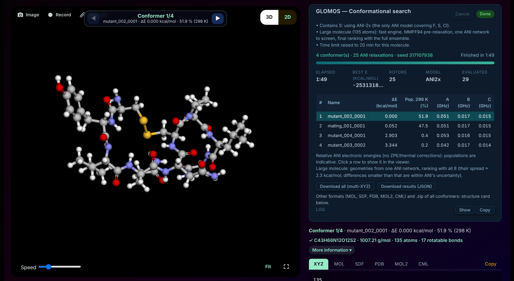

<p align="center">
  
</p>

<p align="center">
  <b>Energy-Minimized Linear-to-Structure Atom Yielding Algorithm</b><br/>
  Convert SMILES strings into optimized 3D molecular structures — interactively and for free.
</p>

<p align="center">
  <a href="https://elaya-smiles.onrender.com/">
    
  </a>
  
  
  
  
</p>

---

<p align="center">
  
  <br/><sub><i>ELAYA SMILES Explorer — Convert any SMILES string into an interactive 3D structure</i></sub>
</p>

---

## What is ELAYA SMILES?

**ELAYA SMILES** is a web-based platform for converting linear molecular representations (SMILES) into optimized three-dimensional structures, enabling visualization and structural analysis within a unified environment.

SMILES (Simplified Molecular Input Line Entry System) provides a compact way to represent molecular structures as text. However, most computational chemistry applications — molecular simulations, docking, property prediction — require accurate 3D geometries. ELAYA bridges that gap by integrating multiple cheminformatics tools to generate reliable 3D conformations, supporting both research and educational workflows.

---

## Features

- **Multi-method SMILES → 3D conversion** — RDKit (ETKDGv3), OpenBabel, and NetworkX (Kamada-Kawai layout with topological distance targets and stereo correction; approximate)
- **Interactive 3D molecular viewer** — Rotate, zoom, and inspect structures in the browser; double and aromatic (Kekulé) bonds drawn from the MOL block; stereo / bond checks and rotational constants shown under the viewer
- **Force field optimization** — Geometry refinement via UFF and MMFF94
- **Conformational search with GLOMOS** — genetic algorithm in torsion space with ANI-1ccx / ANI-2x potentials; live progress, cancel, presets, reproducible seeds
- **Ensemble results** — relative energies, Boltzmann populations (298 K), rotational constants A/B/C, click-to-view conformers
- **Structure checks** — stereochemistry (CIP/E-Z) and bond graph verified against the SMILES; molecule report with warnings (undefined stereocentres, salts, charge, ANI domain)
- **Export** — XYZ / MOL / SDF / PDB (RDKit), MOL2 / CML (OpenBabel); multi-XYZ and JSON for GLOMOS ensembles
- **SMILES reference guide** — Built-in documentation on SMILES notation, encoding rules, and example molecules

---

## Screenshots

<table>
  <tr>
    <td align="center" width="50%">
      
      <br/><sub><b>SMILES reference guide & encoding rules</b></sub>
    </td>
    <td align="center" width="50%">
      
      <br/><sub><b>GLOMOS — Conformational search with genetic algorithm + ANI potentials</b></sub>
    </td>
  </tr>
</table>

---

## Scientific Highlights

**Distance geometry with torsional knowledge (ETKDGv3)** produces realistic conformations using experimental and knowledge-based constraints. **Force field-based optimization** refines geometries using classical methods. **GLOMOS** (Genetic-algorithm-based Local Optimization of MOlecular Structures) goes further — it implements a heuristic genetic algorithm to explore the conformational space of rotatable bonds using ANI-based neural network potentials, approaching quantum-chemical accuracy while avoiding the high cost of DFT calculations.

### Why 3D geometry matters

Accurate 3D structures are critical for molecular dynamics simulations, structure-based drug design, and quantum-chemical calculations. Molecules exist as ensembles of interconverting conformers due to rotation around single bonds — identifying low-energy conformations is essential for understanding real molecular behavior.

---

## Tech Stack

| Layer | Technologies |
|-------|-------------|
| Backend | Flask, Waitress (GLOMOS jobs run in a subprocess) |
| Cheminformatics | RDKit, OpenBabel |
| Conformational search | GLOMOS (ANI1x / ANI1ccx / ANI2x neural potentials) |
| Visualization | 3Dmol.js (browser) |
| Frontend | HTML5, CSS3, JavaScript |

---

## Getting Started

```bash
# Clone the repository
git clone https://github.com/GabrielaVidales/elaya-smiles.git
cd elaya-smiles

# Create and activate virtual environment
python -m venv venv
source venv/bin/activate      # Windows: venv\Scripts\activate

# Install dependencies
pip install -r requirements.txt

# Run the server
python app.py
```

The app will be available at `http://localhost:5000`.

---

## Usage

1. Enter a SMILES string in the input field — or pick one of the built-in examples (Dopamine, Oxytocin, Glucose, Aspirin, Serotonin, Melatonin)
2. Select a **3D Construction Method** (RDKit, OpenBabel, or NetworkX)
3. Optionally apply **Force Field optimization** (UFF, MMFF94)
4. Optionally run **GLOMOS conformational search** for advanced post-optimization
5. Explore the interactive 3D viewer or download the `.xyz` file

---

## GLOMOS in v2 (what it actually does)

1. **Seeds** — RDKit ETKDGv3 conformer pool (reproducible seed) and the chemistry-aware bond graph.
2. **Rotors** — acyclic single bonds not adjacent to a triple bond; symmetric tops (CH3, CF3, t-Bu) excluded; each rotor has a
   preferred-angle alphabet (sp3: 60/180/−60, X–H, planar amide/ester/acid: 0/180, otherwise 8 angles).
3. **Generation 0** — seeds + random torsion variants → ANI relaxation → energy window → USR/energy de-duplication.
4. **Evolution** — roulette selection, crossover of torsion vectors, mutants; every candidate must pass clash, connectivity,
   stereocentre and E/Z checks (before *and after* ANI relaxation). Stops on max generations, stagnation, time limit or cancel.
5. **Final polish** at fmax = 1e-3 eV/Å, ensemble with relative energies, populations and rotational constants.

**Performance.** All candidates of a generation are relaxed together: one batched ANI evaluation per optimisation step
(`elaya_glomos/libbatch.py`, an exact re-implementation of `ase.optimize.LBFGS` run independently for every structure, so the
trajectories are identical to relaxing them one by one; checked in `tests/test_batch_relax.py`). On CPU this is ~2.5–3x faster.
Optional **screening with one ANI network** (`screening: "single"`, "Screening" in the GLOMOS panel) is ~3x faster again; the final
re-optimisation and ranking always use the full ensemble. Use the default (`"ensemble"`) for reference/published results.
`ELAYA_TORCH_THREADS=auto` uses as many torch threads as whole CPUs in the container (1 on fractional-CPU instances).

ANI model *Auto* picks ANI-1ccx for H,C,N,O and ANI-2x when F, S or Cl is present. Open-shell molecules and elements outside
ANI are rejected with an explanation; charged species trigger a warning (ANI is trained on neutral molecules).

Command-line use (same code as the web job): see `validation/run_validation.py` and `glomos_worker.py`.

## API

| Endpoint | Purpose |
|---|---|
| `GET /api/health[?deep=1]` | library availability + versions; `deep=1` runs a real ANI calculation |
| `POST /api/analyze` | `{smiles}` → descriptors, stereo summary, warnings |
| `POST /api/convert` | `{smiles, method: rdkit\|openbabel\|networkx, force_field}` → xyz, mol, QA, rotational constants |
| `POST /api/export` | `{smiles, xyz, format}` → file |
| `POST /api/glomos/start` | `{smiles, glomos_params}` → `{job_id}` |
| `GET /api/glomos/poll/<id>?cursor=n` | structured events, status, queue position |
| `POST /api/glomos/cancel/<id>` | cooperative cancel (partial result is kept) |
| `GET /api/glomos/result/<id>[?format=xyz]` | final ensemble |

Environment: `ELAYA_MAX_JOBS` (concurrent GLOMOS jobs, default 1), `ELAYA_MAX_MINUTES` (per-job limit, default 20),
`ELAYA_TORCH_THREADS` (`auto` = whole CPUs of the container), `ELAYA_ANI_DTYPE` (`float64` default), `ELAYA_JOB_TTL_MIN`, `ELAYA_CORS_ORIGINS`.

## Tests and validation

```bash
python -m pytest tests -q                 # 34 tests; GA/jobs/API logic (uses stand-ins if ase/rdkit/torch are absent)
python validation/run_validation.py       # real pipeline on butane, ethanol, pentane, aspirin, alanine (needs the full image)
python validation/calculate_rotational_constants.py conformers.xyz
```

See `CHANGELOG.md` for what changed and why, and `docs/paper_vs_code.md` for the manuscript review.

## Limitations

Neutral closed-shell molecules (H, C, N, O; plus F, S, Cl with ANI-2x); relative **electronic** energies only (no ZPE, solvent or
entropy); stochastic search without completeness guarantee; ring conformers come from the ETKDG pool; one GLOMOS job at a time
on the hosted instance; ≤ 120 heavy atoms.

## Development

Developed by **Gabriela Yasmin Vidales Ayala** as part of an initiative to bridge cheminformatics tools with accessible, reproducible workflows for molecular modeling.

Special thanks to **Dr. Filiberto Ortiz Chi** and **Dr. Luis Ortiz** for their scientific guidance and support. Part of the [TheoChemMérida](https://github.com/TheoChemMerida) research group at CINVESTAV Mérida.

---

## License

MIT © Gabriela Yasmin Vidales Ayala · TheoChemMérida · CINVESTAV Mérida
